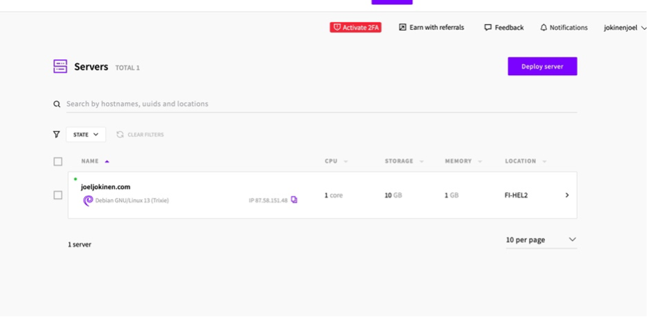
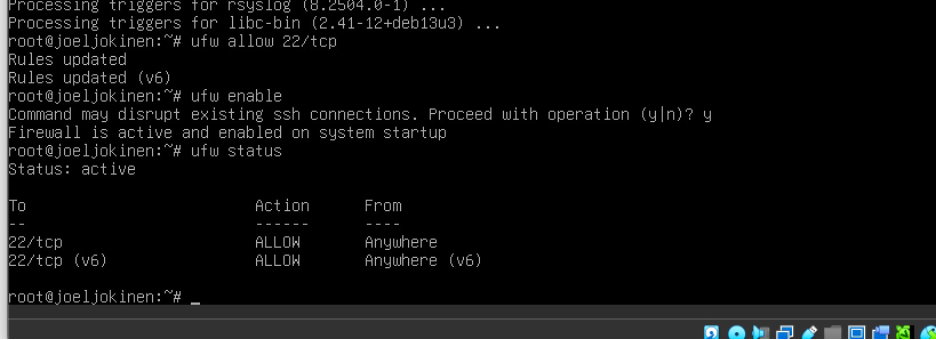
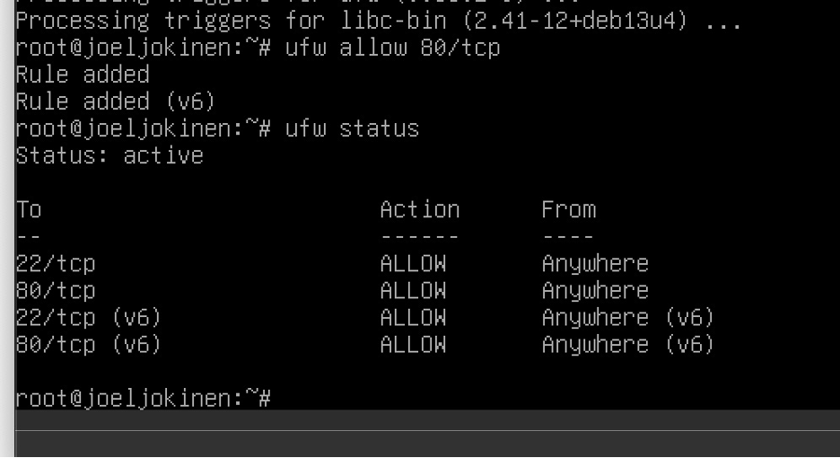
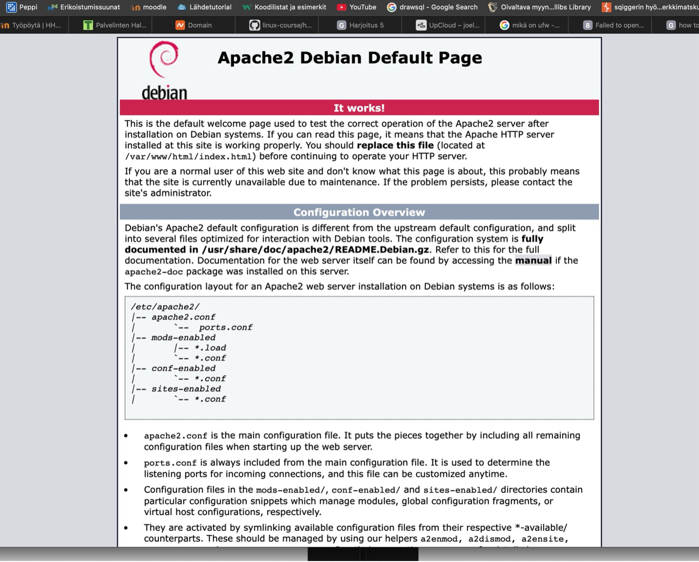
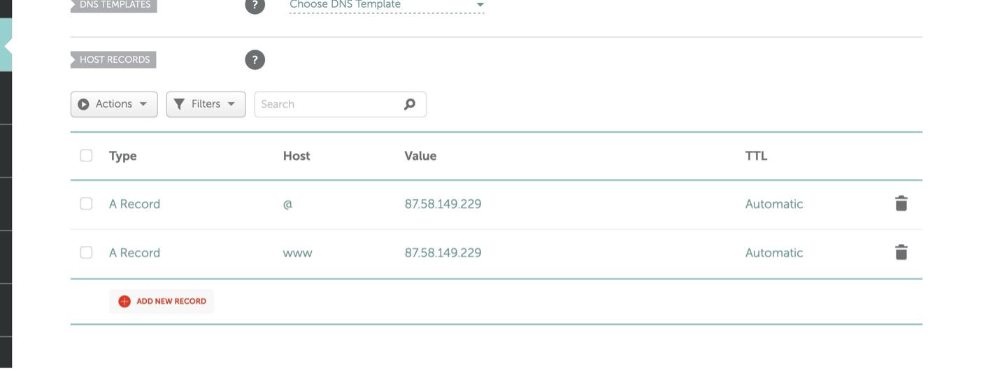
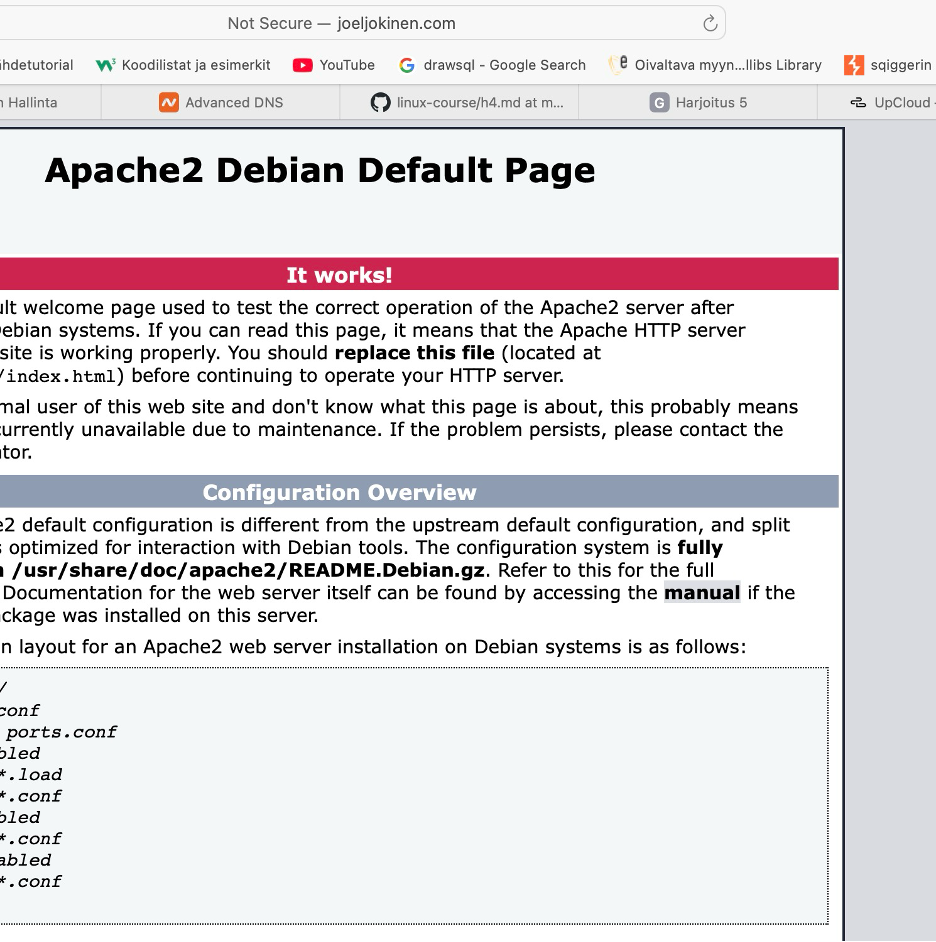
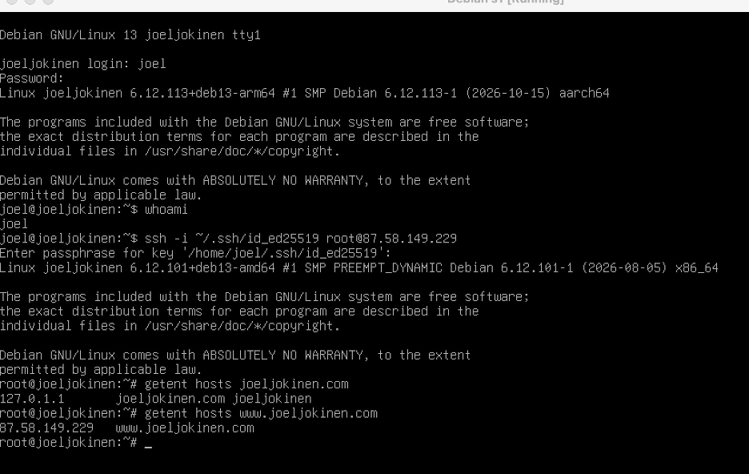

<!DOCTYPE html>
<html lang="fi">
<head>
    <meta charset="UTF-8">
    <meta name="viewport" content="width=device-width, initial-scale=1.0">
    <title>H0 – Oikeasti netissä</title>
</head>
<body style="margin-left: 220px;">

<nav style="position: fixed; top: 10px; left: 10px; background: white; padding: 15px; border: 1px solid black;">
    <strong>Sisällysluettelo</strong>
    <ul>
        <li><a href="index.html">Johdanto</a></li>
        <li><a href="h0.html">H0 – Oikeasti netissä</a></li>
    </ul>
</nav>

<h1 id="johdanto">Raportti 0:</h1>

<h2>Tiivistelmä raportista Niemi 2025: H4 Tehtävät</h2>
<ul>
    <li>Raportissa vuokrataan virtuaalipalvelin UpCloudilta ja se määritetään Debian 13 – käyttöjärjestelmäksi 3€ kuukausimaksulla.</li>
    <li>Palvelimeen yhdistetään SSH-avain ja se otetaan käyttöön. (Luo SHH-avain komennolla ssh-keygen ja lisää julkinen avain palveluntarjoajalle.)
        <ul>
            <li>Palvelimen sijainti vaikuttaa yhteyden nopeuteen ja voi vaikuttaa tietosuojaan.</li>
        </ul>
    </li>
    <li>Luodaan sudo-käyttäjä, määritetään SSH-yhteys ja estetään root-kirjautuminen. (SSH-avaimet mahdollistavat kirjautumisen ilman salasanaa.)</li>
    <li>Asennetaan UFW-palomuuri ja sallitaan SSH-liikenne portissa 22. Aktivoidaan palomuuri komennolla sudo ufw enable.</li>
    <li>Päivitetään järjestelmän ohjelmistot</li>
    <li>Lisäksi asennetaan Apache2-web-palvelin (komennolla sudo apt install apache2), ja muokataan ”/var/www/html/index.html” -tiedostoa</li>
    <li>Avattiin palomuurista portti 80, jolloin verkkosivu näkyy selaimessa</li>
    <li>Sivusto toimii lopuksi palvelimen IP-osoitteella.
        <ul>
            <li>Omana huomiona, SSH-portti pitää sallia ennen palomuurin aktivointia, jottei etäyhteys katkea.</li>
        </ul>
    </li>
</ul>

<h2>Tiivistelmä raportista Partanen 2025: Harjoitus5: Nimekäs: a) Nimi</h2>
<ul>
    <li>Hankittiin domain-nimi Namecheapista, sekä määritettiin DNS:n A-tietue osoittamaan palvelimen IP-osoitetta.</li>
    <li>Domain nimi toimii verkkosivun osoitteena IP-osoitteen sijaan.</li>
</ul>

Oma huomio: Domain nimi on helposti muistettava verrattuna palvelimen IP-osoitteeseen.

Oma huomio kollektiivisesti molemmista: Palvelimen käyttöönotto vaatii useita vaiheita, mutta kuitenkin näiden jälkeen verkkosivuston julkaiseminen on melko yksinkertaista.

<h2>Omia kysymyksiä:</h2>
<ul>
    <li>Voiko palvelimen sijaintia vaihtaa myöhemmin?</li>
    <li>Miten epäonnistuneita SSH-kirjautumisyrityksiä voi seurata?</li>
    <li>Miksi DNS-muutosten näkyminen voi kestää, vaikka asetukset olisi tallennettu oikein?</li>
    <li>Miten HTTPS-yhteyden saa käyttöön Apache-palvelimella?</li>
</ul>

<h1 id="h0">Harjoitus h0 ”Oikeasti Netissä” :</h1>

Aluksi haluan selventää lukijalle, että muutamat kuvankaappaukset on jäänyt ottamatta, koska tein tehtävää ilman tehtävänantoa tunnilla ja vasta sen jälkeen aloitin raportin laatimisen. Lisäksi osa kuvankaappauksista on hiukan vääriä ja saattavat sisältää hiukan erilaisia komentoja esim. sisältäen ”sudo” komentoa. Tämä taas johtuu siitä, että löin päätäni seinään useita tunteja, sillä en tajunnut, että julkinen SSH-avaimeni oli väärin yhdellä merkillä UpCloud palvelinta luodessani.

<h2>a)</h2>

Aloitetaan paikallistaminen. Asensin Virtual Boxin kautta kurssia varten Debian 13 käyttöjärjestelmän ilman graafista käyttöliittymää. Alla kuva (Kuva 1) VirtualBoxista ja Debianin spekseistä. Tein käyttöjärjestelmään muutaman perusasetuksen, kuten käyttäjänimen ja salasanan, sekä loin SSH-avaimen komennolla: ssh-keygen. Julkinen SSH-avaimeni on: ” ssh-ed25519 AAAAC3NzaC1lZDI1NTE5AAAAIMmUAOpLtRuybxuPc/1qeOyCkOQba9A+nGaiNWVStyQ3 joel@joeljokinen”

Kuva 1

<h2>b)</h2>

Seuraavaksi vuokrasin virtuaalisen yksityispalvelimen UpCloudista. Alla kuva valmiin palvelimen spekseistä ja nimestä (Kuva 2). Palvelin maksaa minulle 3€ kuukaudessa. Upcloud yritti myydä muitakin varmasti järkeviä palveluita, mutta en kuitenkaan tarvitse niitä. Valitsin käyttöjärjestelmäksi debian 13, palvelimen sijainniksi Suomen ja lisäsin sinne luomani julkisen SSH-avaimen.

Kuva 2

<h2>c)</h2>

Sitten testasin VirtualBoxin kautta SSH-yhteyden UpCloud palvelimelle suorittamalla ssh -i ~/.ssh/id_ed25519 root@komennon. Sitä seurasi kysely passphrasesta ja annoin luomani passphrase koodin. Terminaali siirtyi siitä etäpalvelimelle UpCloudiin. Nyt kun SSH-yhteys onnistui, testataan vielä sitä whoami komennolla ja sain vastaukseksi, että minulla on root oikeudet ja olen kirjautunut sisään pääkäyttäjänä. Seuraavaksi luodaan käyttäjä ja annetaan sudo-oikeudet. Suoritetaan komennot: adduser joel, usermod -aG sudo joel. Ensimmäinen lisää käyttäjän ja jälkimmäinen taas antaa sille sudo-oikeudet.

Sudo oikeuksien lisäämisen jälkeen asensin UFW-palomuurin (uncomplicated firewall). Ensin päivitettiin pakettiluettelo komennolla: apt update, sitten asennettiin UFW komennolla: apt install ufw. Tärkeää on muistaa sallia SSH komennolla: ufw allow 22/tcp ennen kuin aktivoidaan palomuuri komennolla: ufw enable. Palomuurin tila voidaan tarkistaa komennolla: ufw status (Kuva 3).

Kuva 3

<h2>d)</h2>

Tässä kohdassa päivitin aluksi pakettiluettelon etäpalvelimelta komennolla: apt update ja päivitin asennetut ohjelmistot komennolla: apt upgrade -y. Sitten asensin etäpalvelimelle apache 2 verkkopalvleimen komennolla: apt install apache2 -y (kuva 4). Apache toimii ikään kuin välikätenä verkkosivun vierailijan ja hostin välissä. Se visualisoi nettisivun HTML-koodin verkkosivulla selaimessa. Apachen lataamisen jälkeen täytyy sallia http-liikenne palomuurissa sallimalla portti 80. Sen suoritin komennolla ufw allow 80/tcp. Seuraavaksi voidaan tarkistaa palomuurin tila komennolla: ufw status. Tässä vaiheessa sen pitäisi palauttaa vastaus jossa näkyy, että palomuuri on aktiivinen ja portit 22 ja 80 ovat auki (Kuva 5). Lopuksi voidaan testata verkkopalvelin avaamalla esim. Chromen verkkoselaimessa http://87.58.149.229 (kuva 6)

Kuva 4

Kuva 5

Kuva 6

<h2>e)</h2>

Seuraavaksi tavoitteenani on viimeistellä lopputulos siihen pisteeseen, että minulla on visuaalinen nettisivu verkkoselaimella, se sijaitsee upcloudin hostaamana ja nettisivun osoite on joeljokinen.com. Olen ennalta jo ostanut namecheap.com nettisivustolta domain-nimen ”joeljokinen.com”. Nimi maksoi minulle yhteensä 13.17€ vuodessa. Aluksi kirjauduin taas SSH-etäyhteydellä UpCloud palvelimelleni debianin kautta. Sen jälkeen vierailin namecheapin nettisivuila ja muutin domainini DNS-tietueet oman nettisivuni IP-osoitteeksi. (Kuva 7) Odotin jonkun aikaa ja testasin toiminnan debianin kautta, sekä verkkoselaimen kautta ja lopputulos oli oikea (Kuvat 8 ja 9).

Kuva 7

Kuva 8

Kuva 9

</body>
</html>
