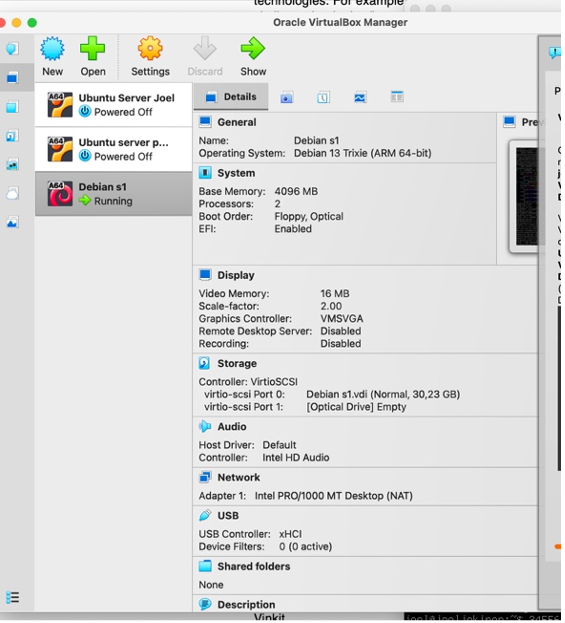
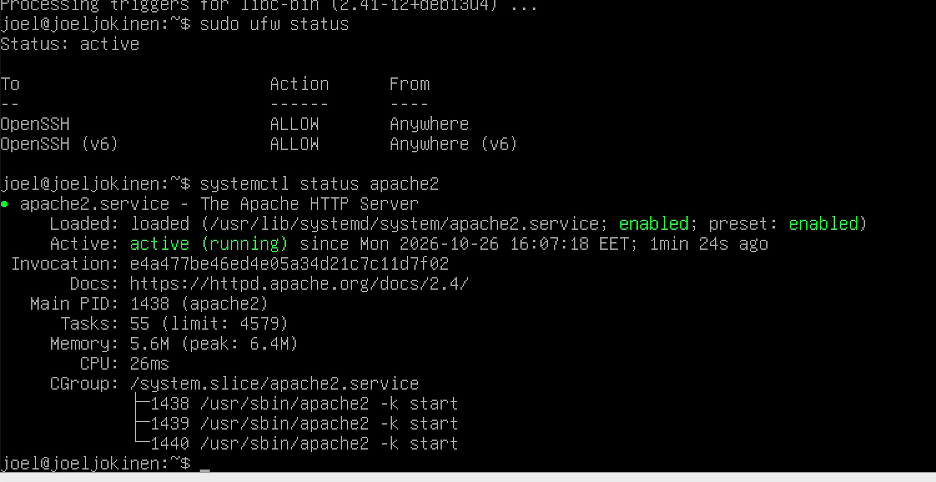

<!DOCTYPE html>
<html lang="fi">
<head>
    <meta charset="UTF-8">
    <meta name="viewport" content="width=device-width, initial-scale=1.0">
    <title>H1 – Hei Ansible</title>
</head>
<body style="margin-left: 220px;">

<nav style="position: fixed; top: 10px; left: 10px; background: white; padding: 15px; border: 1px solid black;">
    <strong>Sisällysluettelo</strong>
    <ul>
        <li><a href="index.html">Johdanto</a></li>
        <li><a href="h0.html">H0 – Oikeasti netissä</a></li>
        <li><a href="h1.html">H1 – Hei Ansible</a></li>
    </ul>
</nav>

<h1>H1 – Hei Ansible</h1>

<h2>Harjoitus H1: Hei Ansible</h2>

Tässä harjoituksessa asensin Debian-palvelimelle SSH-palvelimen ja Ansible-ohjelmiston.
Tämän jälkeen määritin SSH-yhteyden localhostiin ja suoritin Ansiblella yksinkertaisen
Hello World -tehtävän.

<h3>a) SSH-palvelimen asentaminen</h3>

Aloitin asentamalla Debian-palvelimelle SSH-palvelimen. Päivitin ensin pakettiluettelon
komennolla <code>apt update</code> ja asensin SSH-palvelimen komennolla:

<pre>apt install openssh-server</pre>

Tämän jälkeen käynnistin SSH-palvelun ja määritin sen käynnistymään automaattisesti
järjestelmän käynnistyessä:

<pre>systemctl enable --now ssh</pre>

Tarkistin vielä palvelun tilan komennolla <code>systemctl status ssh</code>.
Lopuksi testasin yhteyden localhostiin komennolla:

<pre>ssh joel@localhost</pre>

SSH-palvelimen tila näkyy alla olevassa kuvassa.

<h3>b) SSH-avaimen käyttöönotto</h3>

Minulla oli jo aikaisemmasta tehtävästä SSH-avainpari, joten en luonut uutta avainta.
SSH-avaimen voi tarvittaessa luoda komennolla:

<pre>ssh-keygen -t ed25519</pre>

Seuraavaksi kopioin julkisen SSH-avaimen localhostin käyttäjälle komennolla:

<pre>ssh-copy-id joel@localhost</pre>

Komento lisäsi julkisen avaimen käyttäjän <code>joel</code> tiedostoon
<code>~/.ssh/authorized_keys</code>. Tämän jälkeen testasin SSH-yhteyden uudelleen
komennolla <code>ssh joel@localhost</code>. Yhteys onnistui ilman käyttäjätilin salasanaa,
koska kirjautuminen tapahtui SSH-avaimella.

<h3>c) Ansible-ohjelmiston asentaminen ja testaaminen</h3>

Seuraavaksi asensin Debian-palvelimelle Ansible-ohjelmiston komennolla:

<pre>apt install ansible</pre>

Tarkistin asennuksen onnistumisen komennolla:

<pre>ansible --version</pre>

Loin Ansiblea varten oman hakemiston ja siirryin sen sisälle:

<pre>mkdir ansible-hello
cd ansible-hello</pre>

Loin hakemistoon inventaariotiedoston <code>hosts.ini</code>, johon määritin
localhostin käytettäväksi SSH-yhteyden kautta:

<pre>localhost ansible_connection=ssh ansible_user=joel ansible_ssh_private_key_file=/home/joel/.ssh/id_ed25519</pre>

Testasin yhteyden toimivuuden Ansiblella komennolla:

<pre>ansible all -a 'uptime' -i hosts.ini</pre>

<h3>d) Hello World Ansiblella</h3>

Seuraavaksi loin Ansiblelle asetustiedoston nimeltä <code>ansible.cfg</code>.
Määritin siihen inventaariotiedoston sekä tulosteiden asetukset:

<pre>[defaults]
inventory = hosts.ini
display_args_to_stdout = true</pre>

Tämän jälkeen loin playbook-tiedoston nimeltä <code>site.yml</code>.
Tiedostoon määritin, että Ansible suorittaa hello-roolin kaikille inventaarion koneille:

<pre>- hosts: all
  roles:
    - hello</pre>

Loin roolia varten tarvittavat hakemistot komennolla:

<pre>mkdir -p roles/hello/tasks/</pre>

Lopuksi loin hakemistoon tiedoston <code>main.yml</code>, johon kirjoitin seuraavan tehtävän:

<pre>- copy:
    dest: /tmp/hello-ansible
    content: "Hahaa ansiblehan toimii\n"</pre>

Tehtävän tarkoituksena on luoda tiedosto <code>/tmp/hello-ansible</code> ja kirjoittaa
sinne määritetty teksti. Suoritin playbookin komennolla:

<pre>ansible-playbook site.yml</pre>

Ansible suoritti tehtävän onnistuneesti. Testasin vielä lopputuloksen SSH-yhteyden
kautta lukemalla luodun tiedoston sisällön:

<pre>ssh joel@localhost 'cat /tmp/hello-ansible'</pre>

Komento palautti tiedostoon kirjoitetun tekstin, joten Ansible-tehtävä onnistui.

<h3>Yhteenveto</h3>

Harjoituksen aikana opin asentamaan SSH-palvelimen ja Ansible-ohjelmiston Debianille.
Opin myös määrittämään SSH-avaimilla toimivan yhteyden localhostiin sekä luomaan
Ansiblella yksinkertaisen playbookin. Harjoitus osoitti, kuinka Ansiblella voidaan
suorittaa tehtäviä etäyhteyden kautta ilman, että komentoja tarvitsee suorittaa
jokaisella koneella erikseen.

</body>
</html>
