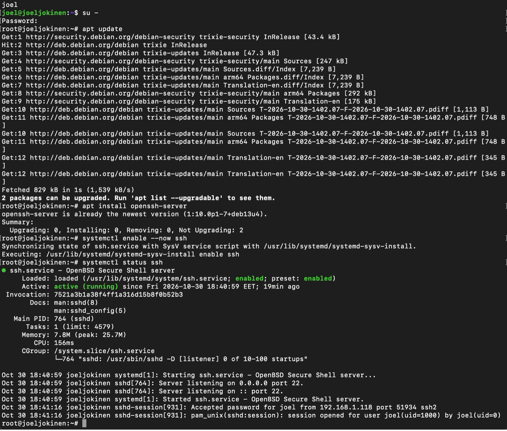
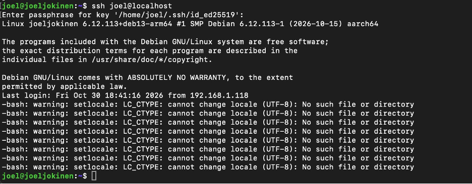
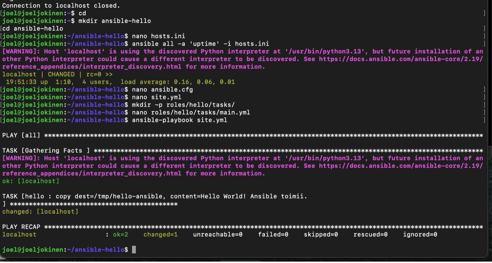
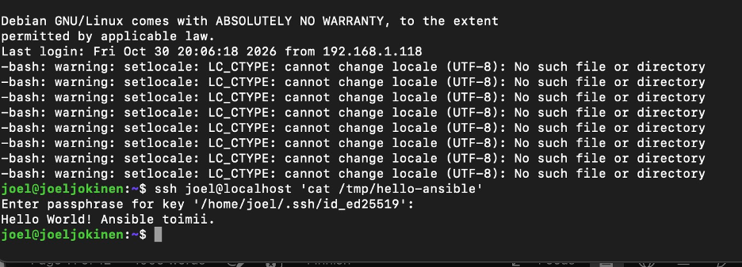

<!DOCTYPE html>
<html lang="fi">
<head>
    <meta charset="UTF-8">
    <meta name="viewport" content="width=device-width, initial-scale=1.0">
    <title>H1 – Hei Ansible</title>
</head>
<body style="margin-left: 220px;">

<nav style="position: fixed; top: 10px; left: 10px; background: white; padding: 15px; border: 1px solid black;">
    <strong>Sisällysluettelo</strong>
    <ul>
        <li><a href="index.html">Johdanto</a></li>
        <li><a href="h0.html">H0 – Oikeasti netissä</a></li>
        <li><a href="h1.html">H1 – Hei Ansible</a></li>
    </ul>
</nav>

<h1>H1 – Hei Ansible</h1>

a) Paikallista linkki raporttiin: <a href="https://joeljokinen.github.io/Joel-Jokinen-palvelinten-hallinta/h0.html">https://joeljokinen.github.io/Joel-Jokinen-palvelinten-hallinta/h0.html</a>

b) Ensimmäisenä kirjauduin Debianiin ja runasin apt updaten. Sitten apt install openssh-server, komento asensi ssh-demonin. Sen jälkeen systemctl enable --now ssh, joka asettaa demonin käynnistymään koneen startupissa ja loppuosa käynnistää sen heti. Sen jälkeen vielä testataan sen tila komennolla systemctl status ssh (Kuva 1). Sitten vielä testattiin kirjautumalla SSH:lla, komennolla ssh joel@localhost.

Kuva 1

c) Jotta voidaan automatisoida SSH-kirjautuminen, täytyy luoda avainpari. Sen olinkin jo aikaisemmassa tehtävässä tehnyt, joten nyt en tehnyt sitä. Kuitenkin komento menee jotakuinkin näin: ssh-keygen -t ed25519. Ensin se kysyy, minne tallennetaan ja sitten passphrasea. Itselläni tässä on passphrase, mutta sitä ei tarvitse. Jos sitä ei laita, tekee se harjoituksen tekemisestä helpompaa, sillä sitä ei kysytä joka kerta kun localhostiin on yhdistämässä.

Seuraavaksi kopioidaan julkinen avain komennolla ssh-copy-id joel@localhost, annettiin käyttäjän salasana ja komento lisäsi avaimen tiedostoon /home/joel/.ssh/authorized_keys. Sitten vain testataan kirjautuminen komennolla ssh joel@localhost ja nyt pääsin kirjautumaan suoraan SSH-avaimella (kuva 2).

Kuva 2

d) Ensimmäisenä latasin Debianilleni Ansiblen root-käyttäjällä komennolla apt install ansible. Ansiblen version voi tarkistaa komennolla ansible --version. Seuraavaksi loin ansible-projektin kansion komennoilla: mkdir ansible-hello ja cd ansible-hello, sekä loin hosts.inin: nano hosts.ini ja täytin sen riveillä:

<pre>localhost ansible_connection=ssh ansible_user=joel ansible_ssh_private_key_file=/home/joel/.ssh/id_ed25519</pre>

Tiedosto määrittelee kohdekoneen (localhost), muodostaa yhteyden SSH:lla, määrittelee käytettävän käyttäjän ja yksityisen SSH-avaimen. Testasin vielä Ansiblen SSH-yhteydellä suorittamalla: ansible all -a 'uptime' -i hosts.ini komennon.

Seuraavaksi loin Ansiblen asetustiedoston komennolla nano ansible.cfg ja kirjoitin sinne rivit:

<pre>[defaults]
inventory = hosts.ini
display_args_to_stdout = true</pre>

Tämän jälkeen Ansible löytää hosts.inin automaattisesti.

Sitten loin site.yml-tiedoston komennolla nano site.yml ja täytin sen riveillä:

<pre>- hosts: all
  roles:
    - hello</pre>

.yml-tiedostoja tehdessä on tärkeää oikea syntaksi!

Seuraavaksi luotiin Hello-rooli seuraavasti: Luotiin kansio ja rooli komennoilla mkdir -p roles/hello/tasks/ ja nano roles/hello/tasks/main.yml. Tiedosto täytettiin koodilla:

<pre>- copy:
    dest: /tmp/hello-ansible
    content: "Hahaa ansiblehan toimii\n"</pre>

Näin määriteltiin, että Ansible luo kohdekoneelle tiedoston, jonka sisällä on tervehdys.

Seuraavaksi voitiin suorittaa ansible-playbook site.yml ja onnistunut tulostus näyttää esimerkiksi, jos tiedostoon on tehty muutoksia (kuva 3).

Kuva 3

Lopuksi vielä varmistin tiedoston syntymisen SSH:n kautta komennolla ssh joel@localhost 'cat /tmp/hello-ansible' (kuva 4).

Kuva 4

</body>
</html>
