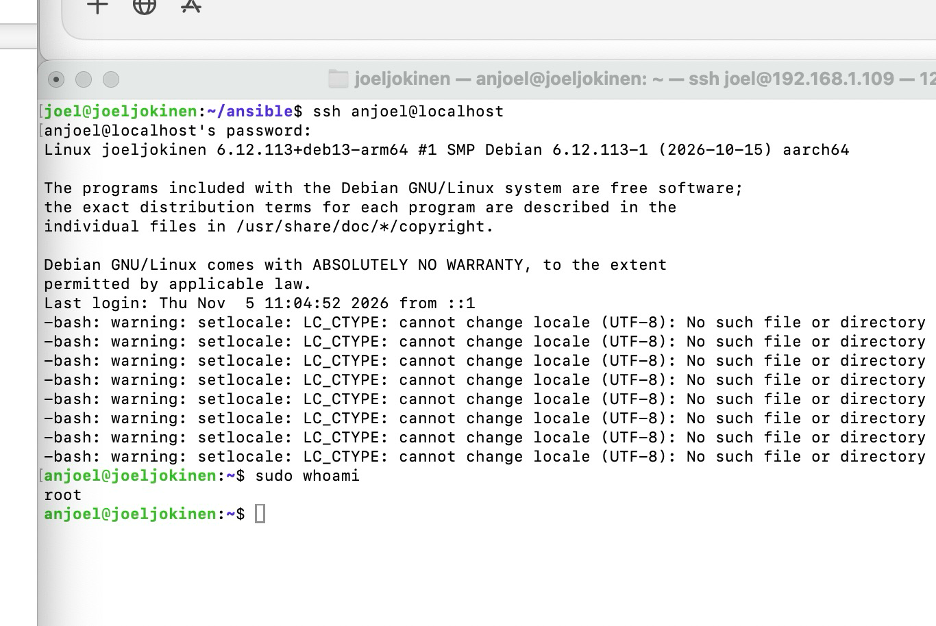
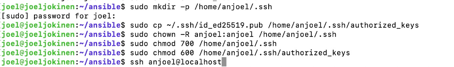
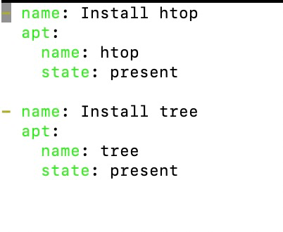
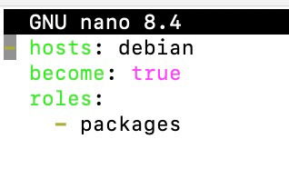
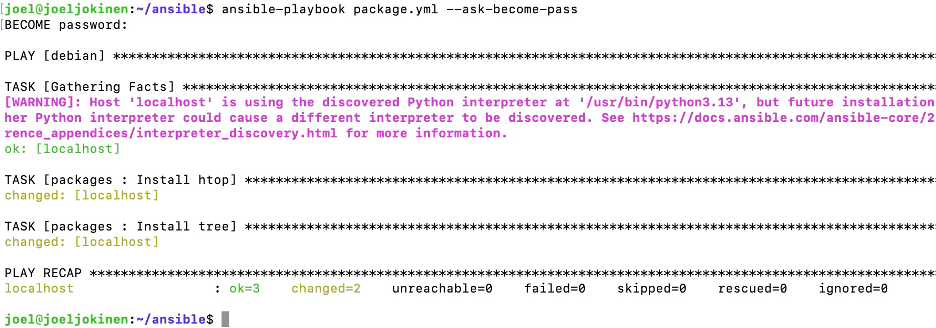
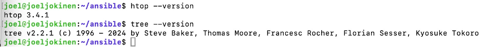
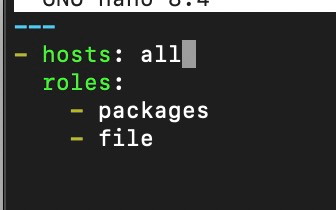
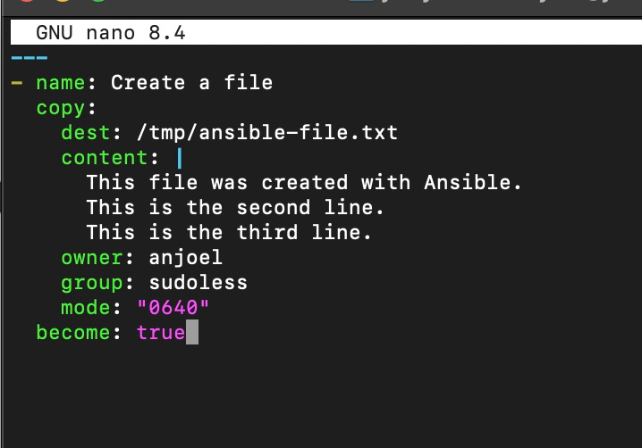
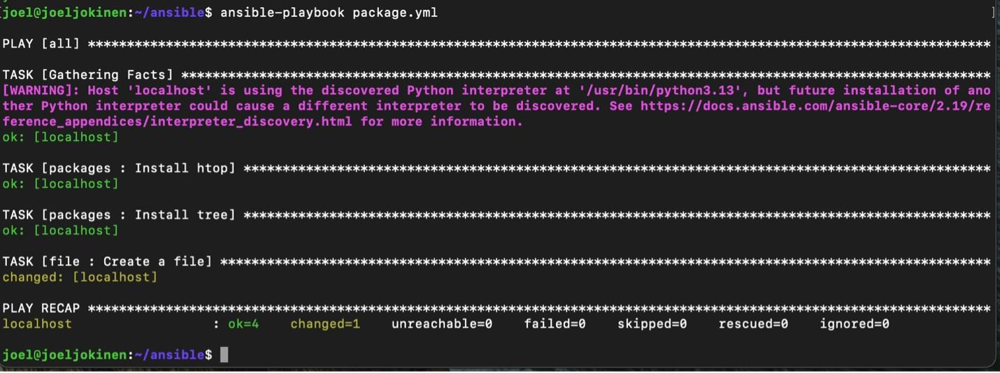
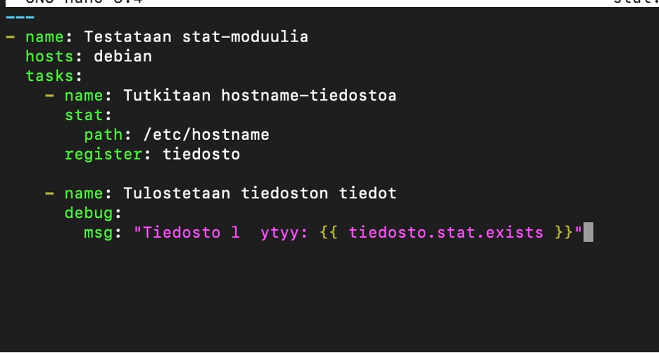

<!DOCTYPE html>
<html lang="fi">
<head>
<meta charset="UTF-8">
<meta name="viewport" content="width=device-width, initial-scale=1.0">
<title>H 2 palvelinten hallinta - sudo voileipä</title>

</head>

<body>

<nav class="toc">
    <strong>Sisällysluettelo</strong> 
    <a href="index.html">Johdanto</a> 
    <a href="h0.html">H0</a> 
    <a href="h1.html">H1</a> 
    <a href="h2.html">H2</a>
</nav>

<h1>H 2 palvelinten hallinta</h1>
<h2>sudo voileipä = sudo without password</h2>

<h2>x)</h2>

1. Karvinen 2026:
<a href="https://terokarvinen.com/passwordless-sudo/#">https://terokarvinen.com/passwordless-sudo/#</a>

<ul>
<li>Linuxissa voidaan määritellä käyttäjäryhmä, jossa jäsenet voi suorittaa sudo-komentoja ilman salasanan kysymistä. Tämä tehdään luomalla uusi ryhmä ja lisäämällä käyttäjä sinne.</li>
<li>Tiedostoon <code>/etc/sudoer.d/</code> lisätään sääntö, joka asettaa salasanattoman sudo-oikeuden ryhmään.</li>
<li><code>visudo</code>- komennolla voidaan muokata sudo-asetuksia turvallisesti, sillä se tarkistaa syhntaksivirheet.</li>
</ul>

2. Munroe 2006:
<a href="https://xkcd.com/149/">https://xkcd.com/149/</a>

<ul>
<li>Sarjakuvassa kerrotaan hauskasti, että sudo komennot totellaan aina.</li>
</ul>

3. Karvinen 2026:
<a href="https://terokarvinen.com/passwordless-sudo-with-ansible/">https://terokarvinen.com/passwordless-sudo-with-ansible/</a>

<ul>
<li>Ansiblella voidaan automatisoida käyttäjien ja ryhmien luominen, sekä niiden sudo-oikeuksien määrittäminen.</li>
<li><code>copy</code>-osalla voidaan luoda sudoers-tiedosto, joka sallii salasanattoman sudon</li>
<li><code>become: true</code> mahdollistaa komentojen suorittamisen pääkäyttäjän oikeuksilla.</li>
<li>Ensimmäisellä suorituskerralla voidaan käyttää <code>–ask-become—password</code> salasanan antamiseen</li>
</ul>

<strong>Omat kysymykset:</strong> Voiko ansivlella määrittää samat käyttöoikeudet samanaikaisesti useille eri palvelimille?

<strong>Oma huomio:</strong> Sudo ilman salasanaa helpottaa automaatiota, mutta voi aiheuttaa tietoturvariskin  jos käyttäjä joutuu vääriin käsiin

<h2>a)</h2>

Tein aluksi tehtävän perusrakenteen jossa lisäsin ansiblen roles kansioon hakemistot: sudoless, anjoel, packages, file ja other komennoilla: <code>mkdir -p roles/sudoless/tasks</code>, <code>mkdir -p roles/antero/tasks</code>, <code>mkdir -p roles/packages/tasks</code>, <code>mkdir -p roles/file/tasks</code> ja <code>mkdir -p roles/other/tasks</code>.

Loin ensin käyttäjän anjoel komennolla: <code>sudo adduser antero</code> ja sitten sudoless ryhmän: <code>sudo groupadd sudoless</code>. Lisättiin anjoel ryhmään komennolla: <code>sudo adduser anjoel sudoless</code> ja annettiin lopuksi sudoers määritus komennolla: <code>sudo visudo -f /etc/sudoers.d/sudoless</code>. Tiedostoon lisättiin: <code>”%sudoless ALL = (ALL) NOPASSWD: ALL”</code>.

Voitiin seuraavaksi testata toiminta kirjautumalla anjoel käyttäjällä komennolla <code>ssh anjoel@localhost</code> ja sudo ei tarvinnut salasanaa (kuva 1).

Kuva 1

<h2>b)</h2>

Seuraavaksi haluttiin että anjoel voi kirjautua automaattisesti ssh:lla ansiblella.

Toteutettiin komennot (kuva 2): <code>sudo mkdir -p /home/anjoel/.ssh</code>, <code>sudo cp ~/.ssh/id_ed25519.pub /home/anjoel/.ssh/authorized_keys</code>, <code>sudo chown -R anjoel:anjoel /home/anjoel/.ssh</code>, <code>sudo chmod 700 /home/anjoel/.ssh</code>, <code>sudo chmod 600 /home/anjoel/.ssh/authorized_keys</code>. Nyt vain anjoel voi lukea, kirjoittaa ja käyttää .ssh hakemistoa, sekä vain anjoel voi lukea ja muokata authorized_keys tiedostoa.

Seuraavaksi voitiin testata tämä runaamalla <code>ssh anjoel@localhost</code>, kirjautuminen toimi ilman salasanaa, mutta kysyttiin kuitenkins passphrase, koska tyhmänä asetin sen kurssin alussa publickeyhyn. Toisaalta se on myös auttanut minua hahmottamaan milloin tehdään mitäkin, sillä pysähdytään passphrase kohtaan.

Lopuksi voidaan panna merkille, että vaikka tässä tehtäväkohdassa ei tehty mitään varsinaisesti ansiblella, niin kuitenkin vaikutettiin ansiblen toimintaan. Ansible toimii SSH-avaimilla ja nyt ansible ei tarvitse salasanaa enää käyttäjälle anjoel.

Kuva 2

<h2>c)</h2>

Valittiin ensin mitä paketteja halutaan asentaa, valitsin htop ja tree paketit. Luotiin hakemisto: <code>mkdir -p roles/packages/tasks</code>. Litten loin main.yml komennolla: <code>nano roles/packages/tasks/main.yml</code> ja lisättiin sinne kuva 3:n koodi.

Tässävaihessa tarvitaan pakettien asentamiseen ansible.playbook. Luodaan se väliaikaisesti <code>nano package.yml</code> komennolla ja lisätään sinne kuva 4:n koodi. Suoritin seuraavaksi playbookin komennolla: <code>ansible-playbook package.yml --ask-become-pass</code>.

Tässä vaiheessa minun piti poistaa ssh-avaimestani passphrase, sillä ansible ei pysty tässä vaiheessa automaattisesti kysymään sitä ja törmätään seinään. Poistin sen komennolla: <code>ssh-keygen -p -f ~/.ssh/id_ed25519</code> jonka löysin valitettavasti chat.gpt:llä:). Oikea tuloste playbookin runaamisesta on kuva 5.

Lopuksi vielä tarkistetaan asennusten oikeus/onnistuminen runaamall <code>htop –version</code> ja <code>tree –version</code>, jos ne eivät tulostuisi, ei ohjelmia olisi asennettukkaan (kuva 6).

Kuva 3

Kuva 4

Kuva 5

Kuva 6

<h2>d)</h2>

Käytetään aiemmin luotua käyttäjää ”anjoel” ja aiemmin tehtyä ryhmää ”sudoless”. Minulla oli jo luotuna file hakemisto ja sille tehtynä tasks hakemisto. Seuraavaksi lisäsin sille uuden tehtävätiedoston: <code>nano roles/file/tasks/main.yml</code>. Lisäsin tehtävätiedostoon koodin kuvassa 7. Siinä kerrotaan tehtävän nimi, tiedoston sijainti ja nimi, tiedoston sisältö, tiedoston omistaja, tiedoston omistava ryhmä, tiedoston käyttöoikeudet ja että tehtävä suoritetaan pääkäyttäjän oikeuksilla. Minulla on tehtynä package.yml, jota käytän tehtävään. Täytän sen seuraavaksi kuvan 8 koodilla. Seuraavaksi voitiinkin ajaa kuvan 9 koodi: <code>ansible-playbook package.yml</code>. Komento ajaa siis aikaisemmin asetetun yml tiedoston ja tekee tiedoston, jonka oikeudet 0640 ovat symbolisessa muodossa <code>-rw-r-----</code>. Oikeudet jakautuvat näin: Omistaja eli tässä tapauksessa anjoel (rw-) voi lukea ja muokata kohdetiedostoa, ryhmä eli suodless (r--) voi lukea tiedostoa, muttei voi muokata sitä ja muut käyttäjät (---) eivät voi lukea, muokata tai suorittaa kohdetiedostoa. Tarkistetaan lopuksi vielä luotiinko tiedosto vaikka playbookin tuloste niin väittääkin. Komennot joita käytin testaukseen: <code>ls -l /tmp/ansible-file.txt</code> ja <code>sudo cat /tmp/ansible-file.txt</code>. Siksi sudo etuliite, koska anjoelilla on lukuoikeudet ja pitää näyttää sudo-komentoa jos käytetään pelkkää joel käyttäjää.

Kuva 7

Kuva 8

Kuva 9

<h2>e)</h2>

Valitaan stat moduuli. Loin tiedoston komennolla <code>nano stat.yml</code> ansibleen. Kirjoitin stat.yml tiedostoon kuva 10 koodi ja tallennettuani suoritin playbookin komennolla <code>ansible-playbook stat.yml</code>. Playbook suorittaa siis ansible-moduulin nimeltä <code>stat</code>, jolla voidaan tutkia tiedostojen ominaisuuksia. Tässä stat tutkii tiedoston olemassaolon ja sen ominaisuudet, register tallentaa saadut tiedot ja debug tulostaa muuttujasta tiedon tiedoston oikeudesta. Tämä oli mielestäni hyvä valinta tehtävään, sillä tällä osoitettiin että ansiblella voidaan tarkistaa palvelime tiedostoja ja hyödyntää tarkistuksen tuloksia.

Kuva 10

</body>
</html>
