<!DOCTYPE html>
<html lang="fi">
<head>
<meta charset="UTF-8">
<meta name="viewport" content="width=device-width, initial-scale=1.0">
<title>H3 - Palvelinten hallinta</title>

</head>

<body>

<nav class="toc">
    <strong>Sisällysluettelo</strong> 
    <a href="index.html">Johdanto</a> 
    <a href="h0.html">H0</a> 
    <a href="h1.html">H1</a> 
    <a href="h2.html">H2</a> 
    <a href="h3.html">H3</a>
</nav>

<h1>H3</h1>

<h2>x) tiivistä</h2>

1. Karvinen 2026: Apache installed with Ansible.

<ul>
<li>Apachen asennus voidaan automatisoida Ansiblen kautta</li>
<li>Palvelimen käyttöönotto voidaan tehdä kolmella vaiheella. Vaiheet ovat paketin Asentaminen, asetustiedostojen muokkaaminen ja palvelun käynnistäminen.</li>
<li>Ansiblella asennetaan Apache apt-modulilla, kopioidaan astuestiedostoja ja hallitaan palvelua.</li>
<li>Handlersilla Apache voiaan käynnistää uudelleen automaattisesti, kun asetustiedostoja muutetaan.</li>
<li>Verkkosivut voidaan sijoittaa käyttäjän omaan kotihakemistoon, jolloin niiden muokkaamiseen ei tarvita root tai sudoa.</li>
</ul>

<strong>Oma huomio teron raportista:</strong> Koen hyödylliseksi, että verkkosivuja voi muokata tavallisena käyttäjänä ilman ylläpitäjän oikeuksia.

2. Ansible Community Doc: Handlers – Running operations on change

<ul>
<li>Handler suoritetaan vain silloin, kun jokin toinen tehtävä ilmoittaa siitä muutoksen yhteydessä.</li>
<li>Hadlereita käytetään palvelujen uudelleenkäynnistämiseen asetustiedostojen muuttamisen jälkeen.</li>
<li>Käynnistetään notify-avainsanalla</li>
<li>Handler suoritetaan oletuksena vasta kun muut tehtävät on suoritettu.</li>
<li>Jos sama handlerii saa ilmoituksen useita kertoja, se suoritetaan kuitenkin vain kerran.</li>
<li>Notifylla voidaan ilmoittaa yhdelle tai useammalle handlerille.</li>
</ul>

<strong>Oma huomio:</strong> Handlers vägentää turhia uudelleen käynnistyksiö ja yksi tehtävä voi myls ilmoittaa useammalle handlerille samanaikaisesti.

<h2>a)</h2>

Tässä tehtävässä asensin Apache 2 webbiselaimen käsin debianin komentorivin kautta. Webbisivun tarkoitus oli näkyä palvelimen etusivulla ja sivun tuli olla muokattavissa tavallisen käyttäjän toimesta.

Aloitin ensin normaalilla pakettien päivittämisellä sudo apt update. Sitten asensin apachen komennolla sudo apt install apache2. Kuvassa 1 katsotaan vielä apachen status ja asetetaan palvelu käynnistymään koneen käynnistyessä. Minulla oli jo ladattuna apache2 ja olin muuttanut oletussivua index.html:ää oman näköisekseni. Testasin toiminnan komennolla: curl http://localhost (kuva 2). Kuvassa 3 tein verkkosivulle oman hakemiston ja lisäsin sinne erikseen uuden html tiedoston kotisivua varten, ideana on se, että apache käyttäisi tätä oletussivuna eikä perus index.html. Apachen täytyy siis tulla pysyä kulkemaan kotihakemiston läpi ja lukemaan tiedosto. Annoin kotihakemistolle suoritusoikuden muille käyttäjille chmod o0x ~komennolla ja kuvassa 4 näkyy vielä seuraavat tarvittavat komennot, jotta html tidostolle saadaan lukuoikeudet ja yleissivu kansiolle suoritusoikeus. Seuraavaksi muutin apachen asetuksia avaamalla apachen oletusasetustiedoston komennolla: sudo nano /etc/apache2/sites-available/000-default.conf. Muutin tiedostoa siten, että DocumentRoot kohtaan muutin juuri luomani hakemiston ja lisäksi sallin directory sulkeiden sisällä että kaikilla pyynnön tekevillä on lupa päästä hakemistoon. Voidaan vielä testata asetukset ajamalla sudo apache2ctl configtest: odotettu tulos Syntax OK ja sitten vielä käynnistin apachen uudelleen komennolla sudo systemctl restart apache2. Verkkosivu toimii nyt ja se voidaan tulostaa komentoriville HTML-koodina curlaamalla http://localhost. Kokeilin vielä, voinko tehdä muutoksia komennolla nano ~/yleissivu/index.html ja se toimi, sillä olin asettanut oikeudet.

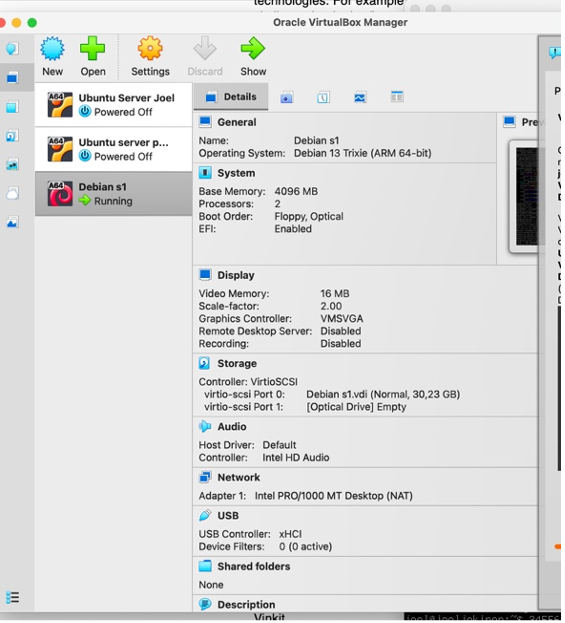

Kuva 1

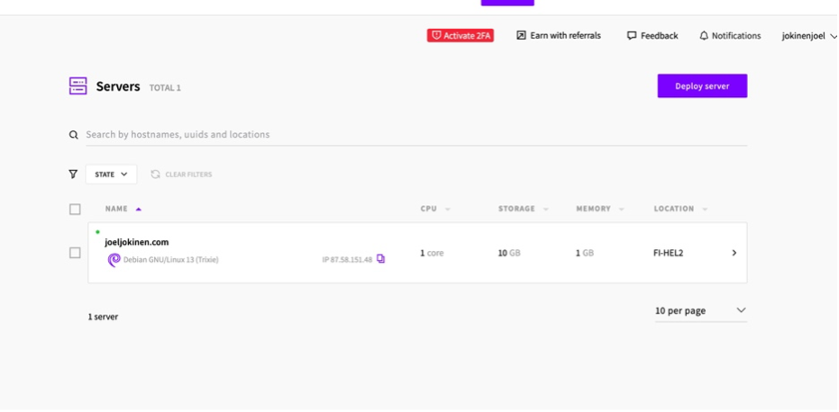

Kuva 2

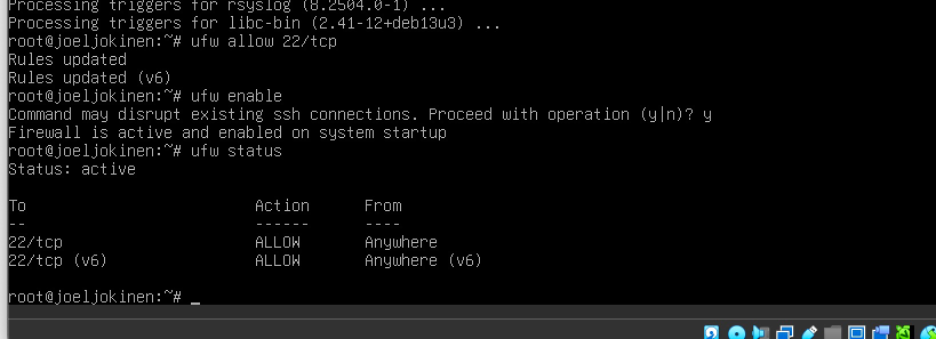

Kuva 3

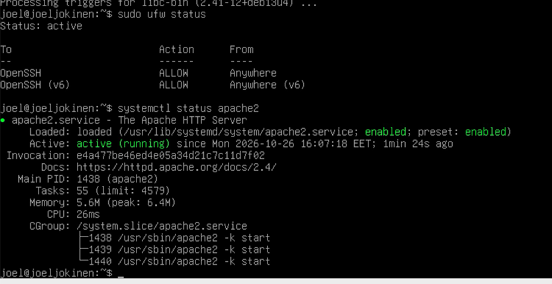

Kuva 4

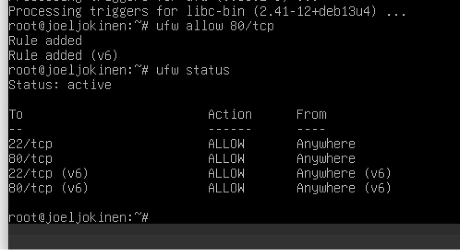

Kuva 5

<h2>b)</h2>

Aloitin tehtävän sammuttamalla Apache2 komennolla sudo systemctl stop apache2. Lisäksi kumosin sen automaattisen käynnistymisen niin ei käy hassusti, komento sudo systemctl disable apache2. Jos ymmärsin oikein, apache ja nginx ei voi kuunnella samanaikaisesti samaa IP-ooitetta ja portia 80.

Jatkettiin tehtävää päivittämällä paketit sudo apt update komennolla ja nginx asennettiin komennolla sudo apt install nginx. Demoni käynnistettiin samoin tavoin kuin apache komennolla sudo systemctl enable nginx. Seuraavaksi testasin toiminnan curl http://localhostilla, kuitenkaan nginxin default sivua ei ilmestynyt, vaan alkoi demoni käyttää aikaisemmin tehtävää h0 varten muuttamaani tiedostoa var/www/html/index.html tiedostoa (kuva 6). Nginx ei siis kirjoita yli tai poista jo olemassa olevia samannimisiä tiedostoja.

Seuraavaksi tein verkkosivusta tavallisen käyttäjän muokattavan. Muutin hakemiston omistajaksi käyttäjän joel komennolla sudo chown -R joel:joel /var/www/html. Oikeudet voidaan tarkistaa tiedostolta komennolla ls -ld /var/www/html. Kokeilin vielä muokata tiedostoa ja se toimii käyttäjällä joel (kuva 7). Tehtävä on siis valmis.

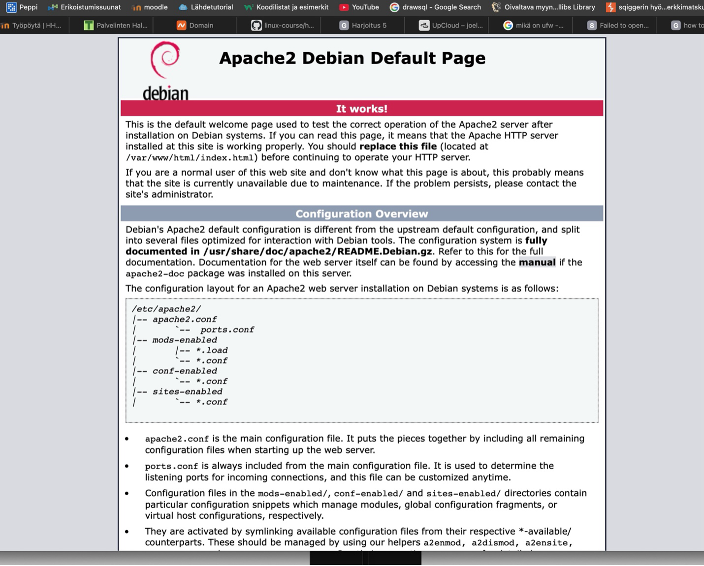

Kuva 6

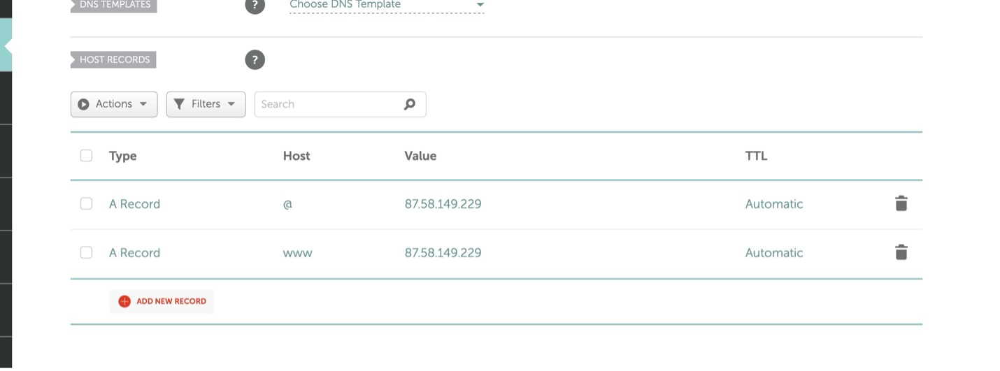

Kuva 7

<h2>c)</h2>

Tehtävän tavoitteena oli, että Ansible huolehtii Nginxin ylläpidosta ja asentamisesta automaattisesti. Käytin tässä aikaisemmin tehtyä Ansible projektia.

Loin ensiksi Nginxille oman roolin ja hakemistorakenteet (Kuva 8). Sitten tein jo jotenkin tutulla tavalla tehtävät main.yml tiedostoon. Kuvassa 9 nähdään lisäämäni prosessit, ajattelin että on fiksua käskeä ansible pysäyttämään apachen, sillä se saattaa olla asennettu ja pyörimässä ja molemmat eivät toimi samanaikaisesti. Toka prosessi asentaa Nginxin, kolmas antaa oikeuden demonille lukea käyttäjän kotihakemiston verkkosivutiedostoa. Neljäs prosessi varmistaa, että käyttäjät (joel) pystyy muokkaamaan HTML-tiedostoa, jota Nginx käyttää. Lopuksi viides prosessi käynnistää Nginxin ja asettaa sen käynnistymään automaattisesti startupissa. Tässä tiedostossa myös määritetään, että käytetään ”yleissivu” nimistä verkkosivun oletussivua, jonka loin aikaisemmissa tehtävissä.

Seuraavaksi loin asetustiedoston komennolla nano roles/nginx/files/default. Kuvassa 10 näkyy koodi mitä lisäsin tiedostoon. Eka kohta kuuntelee porttia 80, toinen rivi määrittää verkkosivun tiedostojen sijainnin, kolmas rivi määrittää oletussivun ja neljäs/viides rivi tarkistaa löytyykö pyydetty tiedost, url-osoitetta vastaava hakemisto ja jos kumpaakaan ei löytynyt, palauttaa koodi 404-virheen.

Seuraavaksi lisäsin vielä tehtävätiedostoon asetustiedoston automaattisen kopioinnin. Komennolla nano roles/nginx/tasks/main.yml tiedosto auki ja lisäsin sinne ennen Nginxin käynnistämistä kuvan 11 highlitatut tehtävät.

Loin seuraavaksi handlerin, palvelun uudelleen käynnistystä varten sellaiseen tilanteeseen kun asetustiedostoon on tullut muutoksia (kuva 12). Nyt demoni käynnistetään uudelleen vasta sitten, kun asetukset omaava tiedosto muuttuu.

Loin playbookin projektin juureen komennolla nano nginx.yml ja lisäsin tiedostoon kuvan 13 tehtävät. Seuraavaksi suoritin Ansiblen ajamalla ansible-playbook nginx.yml –ask-become-pass komennolla. Kuvassa 14 näkyy tuloste, minkä Ansible tulostaa toisen suorituskerran jälkeen. Tehtävä on siis onnistunut ja lopputulos on idempotentti, sillä vaikka ajetaan kuinka monta kertaa, muutoksia ei ole.

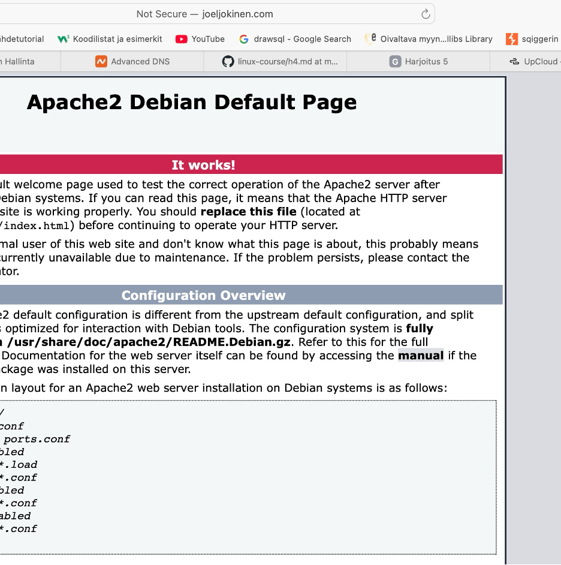

Kuva 8

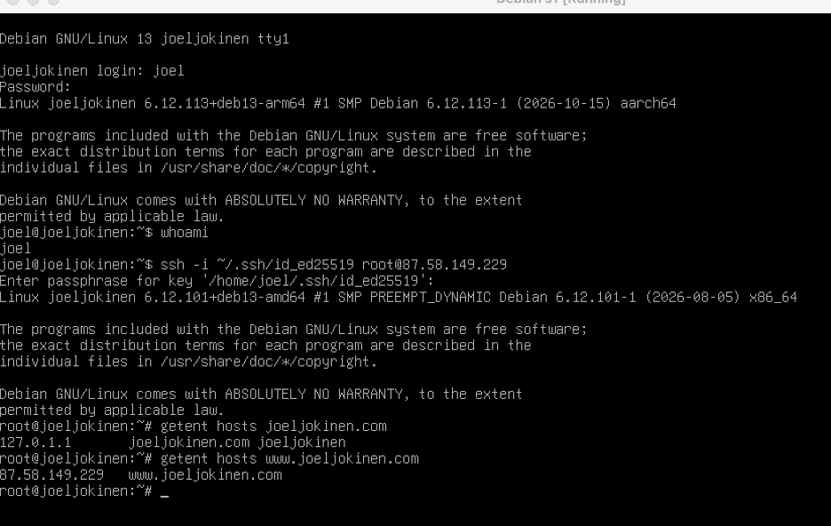

Kuva 9

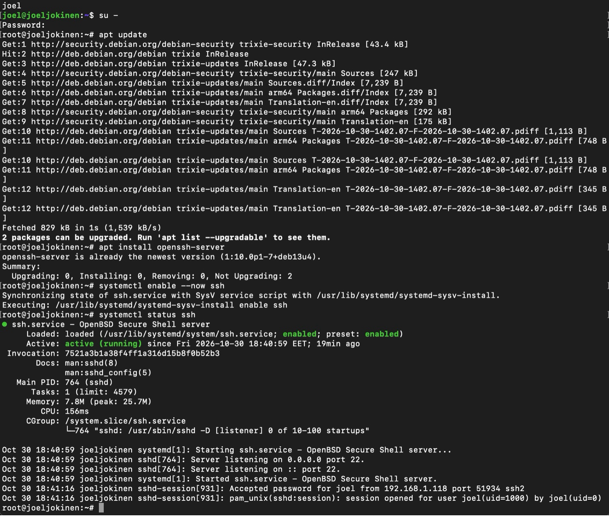

Kuva 10

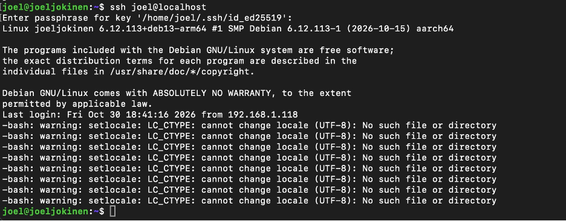

Kuva 11

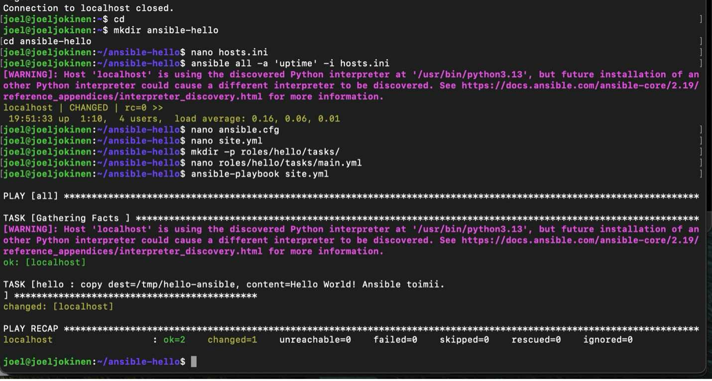

Kuva 12

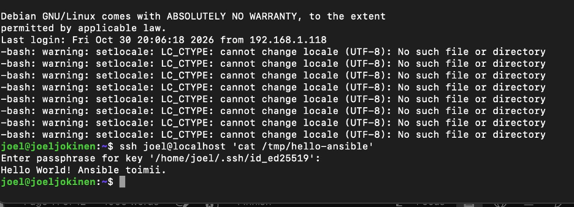

Kuva 13

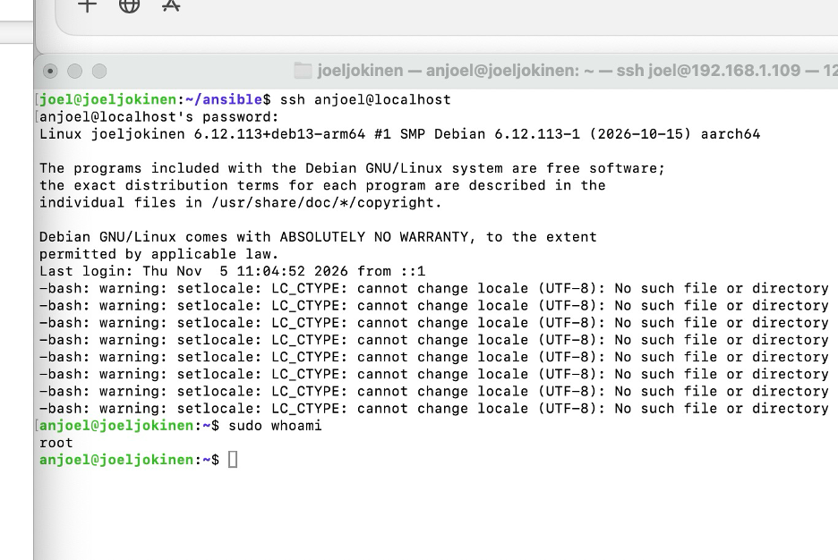

Kuva 14

<h2>Lähteet:</h2>

Tero Karvinen 2026: Apache installed with Ansible - <a href="https://terokarvinen.com/apache-ansible/">https://terokarvinen.com/apache-ansible/</a> Luettu 12.11.2026

Ansible Community Doc: Handlers – Running operations on change - <a href="https://docs.ansible.com/projects/ansible/latest/playbook_guide/playbooks_handlers.html">https://docs.ansible.com/projects/ansible/latest/playbook_guide/playbooks_handlers.html</a> Luettu 12.11.2026

3. Ansible Community Documentation: Sample Ansible setup. <a href="https://docs.ansible.com/projects/ansible/latest/tips_tricks/sample_setup.html">https://docs.ansible.com/projects/ansible/latest/tips_tricks/sample_setup.html</a> Luettu 13.11.2026

</body>
</html>
