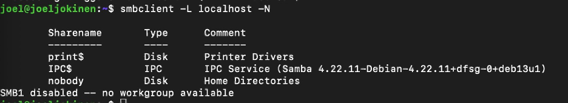
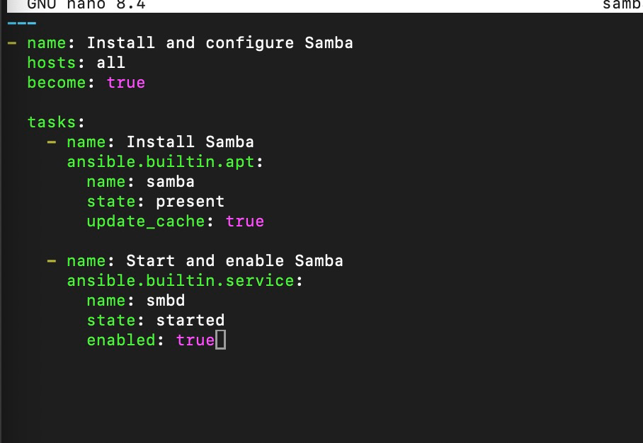
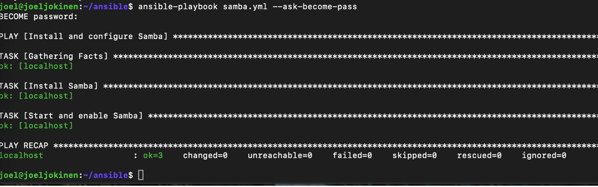
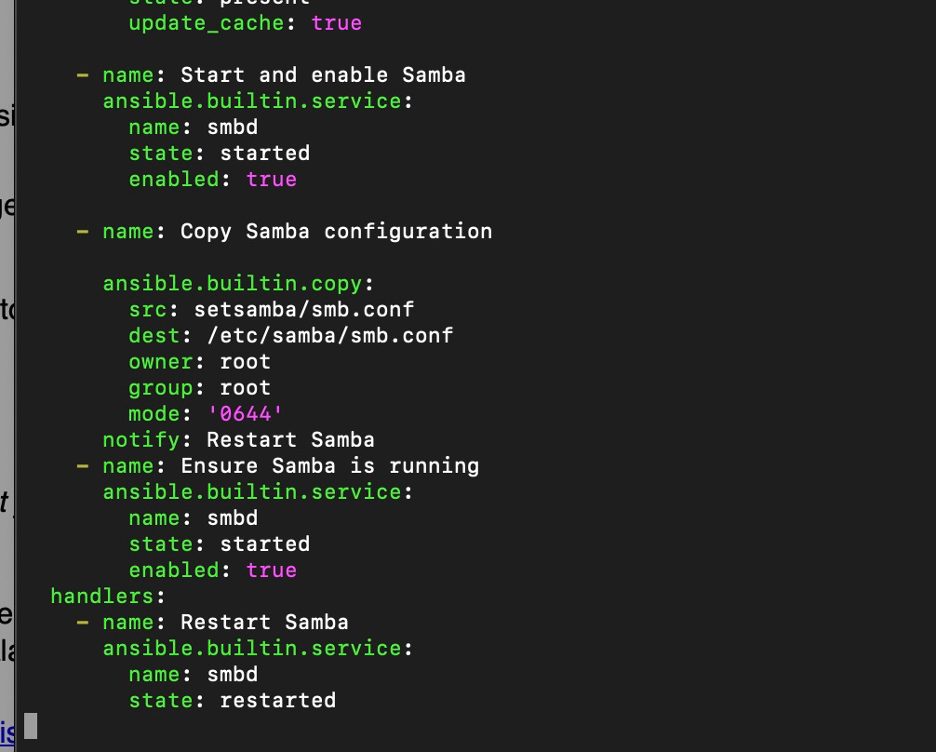
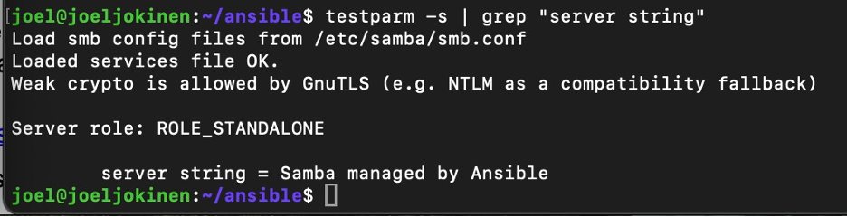
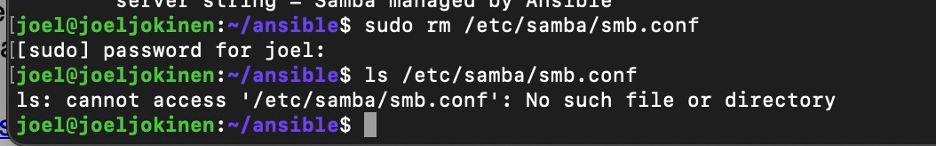
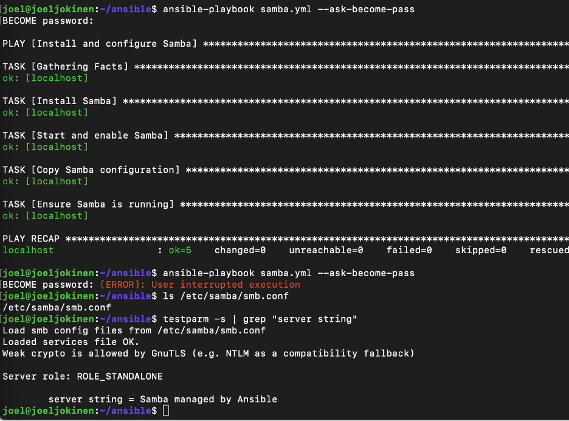
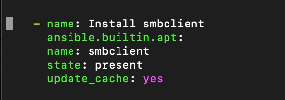
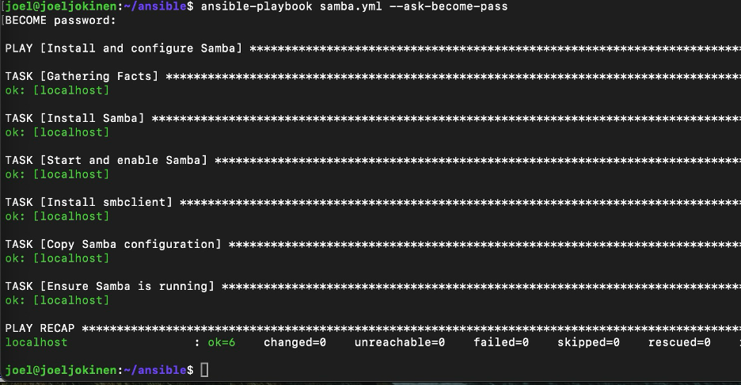
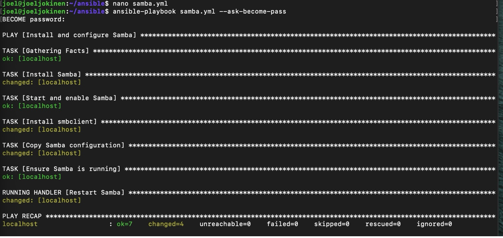

<DOCTYPE html>
<html lang="fi">
<head>
<meta charset="UTF-8">
<meta name="viewport" content="width=device-width, initial-scale=1.0">
<title>H4 - Palvelinten hallinta</title>

</head>
<body>
<nav style="position: fixed; top: 10px; left: 10px; background: white; padding: 15px; border: 1px solid black;">
    <strong>Sisällysluettelo</strong>
    <ul>
        <li><a href="index.html">Johdanto</a></li>
        <li><a href="h0.html">H0 – Oikeasti netissä</a></li>
        <li><a href="h1.html">H1</a></li>
        <li><a href="h2.html">H2</a></li>
        <li><a href="h3.html">H3</a></li>
        <li><a href="h4.html">H4</a></li>
    </ul>
</nav>
<h1>H4</h1>
<h2>x)</h2>

<strong>4.12.1</strong>

<ul>
<li>Hallintatyökalujen DSL-ohjelmointikielet voivat olla todella monimutkaisia.</li>
<li>Saltissa on 510 eri toimintoa ja niiden dokumentaatio on yli 75000 sanaa pitkä.</li>
<li>Puppet sisältää 113 valmista toimintoa.</li>
<li>Molemmat käyttävät omia ratkaisujaan ohjelmointikielen perinteiden rakenteiden sijasta.</li>
</ul>

Oma huomio: Todella laajat toiminnot tekevät uudesta työkalusta vaikeamman oppia.

<strong>4.12.2</strong>

<ul>
<li>Tässä tutkittiin oikeita Puppet-konfigeja Mozillan ja USA:n hallinnon esimerkkien kautta.</li>
<li>Havaittiin, että vaikka työkaluissa on paljon toimintoja, niin vain osaa käytetään usein.</li>
<li>Yleisimmät toiminnot olivat file, package, exec ja service.</li>
<li>Palveluiden asentaminen tapahtuu useimmiten package->file->service komennoilla.</li>
<li>Tutkimuksessa todettiin, että suuren osan tavallisista konfiguraatioista voidaan toteuttaa pienellä määrällä komentoja.</li>
</ul>

Oma huomio: Tutkimuksen tulokset huomaa myös meidän Ansible-tehtävissä. Esim. Apachen asennuksessa tarvitaan periaatteessa vaan paketin asennusta, sen asetustiedoston hallintaa ja palvelun käynnistystä.

4.12.3.1

<ul>
<li>Konfiguraationhallinnan tärkeimpiä komentoja on exec ja file.</li>
<li>Niiden avulla voidaan käyttää muita komentoja, kuten package, service, user ja group.</li>
<li>Osa toiminnoista on riippuvaisia toisistaan, esim. palvelun käynnistäminen edellyttää sitä, että se ohjelmisto on ensin asennettu.</li>
<li>Konfiguraationhallinnan pitää olla idempotenttia eli saman toiminnon suoritus ei aiheuta mitään ylimääräisiä muutoksia.</li>
<li>Yksinkertaisista perustoiminnoista voidaan rakentaa monimutkaisempia toimintoja.</li>
</ul>

<strong>Oma huomio:</strong> Ansiblen kanssa tämä näkyy esim. siinä, että Apache asennetaan ennen sen asetustiedostojen käsittelyä tai sen käynnistämistä. Tehtävät pitää tehdä siis oikeassa järjestyksessä ja Ansibleen ne pitää järjestää, jotta se osaa automaattisesti tehdä ne.

<h2>a) Käsin</h2>

Päätin valita demoniksi Samban, se mahdollistaa esim. tiedostojen ja kansioiden jakamisen verkossa. Tällä Linux-palvelin voisi jakaa tiedostoja esim. Windows-koneelle.

Aloitin tutulla tavalla pakettilistan päivittämisellä, ja sitten asensin Samban käsin komennolla <code>sudo apt install samba</code>. Onnistunut asennus voitiin tunnistaa komennolla <code>systemctl status smbd</code>. Kuoletin vielä edellisen tehtävän jäljiltä nginxin ja deaktivoin sen automaattisen käynnistymisen komennoilla <code>sudo systemctl stop nginx</code> ja <code>sudo systemctl disable nginx</code>.

Seuraavaksi tarkistin Samban asetukset komennolla <code>testparm</code> ja syntaksi oli ok. Halusin testata vastaako Samba komennolla <code>smbclient -L localhost -N</code>. Sitä varten piti vielä asentaa smbclient komennolla <code>sudo apt install smbclient</code>. Komennolla <code>smbclient -L localhost -N</code> saadaan vastaukseksi kuva 1. Tässä näkyy että Samba vastaa, sillä se listaa kansiot mitä on jaettuna verkossa ja Samban sisäisenä järjestelmäjakona. Varmistin lopuksi vielä että samba kuuntelee verkkoyhteyksiä TCP-portista 445 komennolla: <code>sudo ss -tulpn | grep smbd</code>.

Kuva 1

<h2>b) Automaatti</h2>

Käytetään tähän vain kahta ansible moduulia: apt ja service.

Loin ensiksi uuden playbookin ansible hakemistoon komennolla <code>nano samba.yml</code>. Kirjoitin tiedostoon kuva 2 sisällön. Suoritin seuraavaksi playbookin komennolla <code>ansible-playbook samba.yml –ask-become-pass</code> ja playbook toimi (kuva 3). Voidaan vielä testata, että samba toimii edelleen komennolla <code>systemctl status smbd</code>. Odotettu tulos on Active. Testasin vielä automaation idempotenttiuden suorittamalla playbookin useampaan kertaan.

Kuva 2

Kuva 3

<h2>c)</h2>

Käytetään tähän Ansiblella copy-moduulia ja service-moduulia.

Loin ensin kansion asetustiedostolle komennolla: <code>mkdir -p setsamba</code>. Kopioin alkuperäisen Samban asetustiedoston hakemistoon komennolla <code>cp /etc/samba/smb.conf setsamba/smb.conf</code>. Seuraavaksi muokkasin kopioimaani asetustiedostoa ja lisäsin tiedoston [global] osioon asetuksen: <code>server string = Samba managed by Ansible</code>. Seuraavaksi lisäsin samba.yml playbookkiin kuvan 4 moduulit. Kuvassa copy kopioi control nodella muokatun asetustiedoston palvelimelle, notify ilmoittaa samban uudelleenkäynnistyksestä, jos asetustiedosto muuttuu. Handler suorittaa uudelleen käynnistyksen ja state: restarted käynnistää Samban uudelleen. Samban playbookin syntaksi voidaan testata komennolla <code>ansible-playbook –syntax-check samba.yml</code> ja haluttu tuloste on playbook: samba.yml.

Seuraavaksi ajoin ansible-playbookin uudestaan muutaman kerran ja muutokset astuivat voimaan. Todistin komennolla että toimii: <code>testparm -s | grep "server string"</code> (kuva 5).

Kuva 4

Kuva 5

<h2>d)</h2>

Rikotaan tarkotuksella Sambaa ja poistin palvelimen alkuperäisen asetustiedoston komennolla <code>sudo rm /etc/samba/smb.conf</code>. Kuvassa 6 näkyy, ettei tiedostoa enää ole. Seuraavaksi ajoin taas playbookin kahdesti ja kuvassa 7 näkyy, että ansible on korjannut tilanteen ja palauttanut ”vahingossa” poistetun tiedoston.

Pidin vielä vähän hauskaa ja poistin Samban asennuksen kokonaan ja kokeilin korjaako Ansible asian. Käytin komentoa <code>sudo apt-get purge samba-common -y</code> samban poistamiseen. Testasin poistamisen <code>systemctl status smbd</code> komennolla ja palvelua ei löytynyt. Seuraavaksi ajoin taas samban playbookin ja tällä kertaa kesti hiukan kauemmin, sillä se asensi Samban uudestaan. Ansible korjasi taas tilanteen.

Huomasin kuitenkin, että smbclient poistuu samalla kun Samban poistaa, täytynee senkin asennus lisätä playbookkiin. Tein sen lisäämällä kuva 8 tehtävän ja nyt playbook asentaa myös smbclientin onnistuneesti. Todistin vielä, että asennus onnistui.

Kuva 6

Kuva 7

Kuva 8

<h2>e)</h2>

Todistin tilan olevan idempotentti ajamalla saman playbookin kolme kertaa peräkkäin. Ensimmäisellä ajokerralla Ansible suoritti tarvittavat muutokset, tässä tapauksessa asensi Samban ja smbclientin ja toisella ajolla Ansible suoritti tehtävät ilman muutoksia. Ajoin vielä kolmannen kerran ja Ansible ei tehnyt mitään muutoksia. Tämä osoittaa, että Ansible-konfiguraationi on idempotentti. Samaa playbookkia voidaan ajaa useita kertoja, ilman että se tekee mitään tarpeettomia muutoksia. Kuvat 9 ja 10 ovat ensimmäisen ja toisen ajamiskerran tulosteet.

Kuva 9

Kuva 10

<h2>f)</h2>

Pari hankittu: Sebastian Arekari.

<h2>Lähteet:</h2>

Tero Karvinen: palvelinten hallinta, Luettu 20.11 
<a href="https://terokarvinen.com/palvelinten-hallinta/">https://terokarvinen.com/palvelinten-hallinta/</a>

Ansible Community documentation, Luettu 21.11 
<a href="https://docs.ansible.com/projects/ansible/latest/collections/ansible/builtin/apt_module.html">https://docs.ansible.com/projects/ansible/latest/collections/ansible/builtin/apt_module.html</a>

Ansible – Introduction to modules, Luettu 21.11 
<a href="https://docs.ansible.com/projects/ansible/latest/module_plugin_guide/modules_intro.html">https://docs.ansible.com/projects/ansible/latest/module_plugin_guide/modules_intro.html</a>

Samba - testparm, Luettu 21.11 
<a href="https://www.samba.org/samba/docs/current/man-html/testparm.1">https://www.samba.org/samba/docs/current/man-html/testparm.1</a>

Lähde: Karvinen, T. (2023), Configuration Management of Distributed Systems over Unreliable and Hostile Networks, Luettu 20.11 
<a href="https://westminsterresearch.westminster.ac.uk/item/w7vvz/configuration-management-of-distributed-systems-over-unreliable-and-hostile-networks">https://westminsterresearch.westminster.ac.uk/item/w7vvz/configuration-management-of-distributed-systems-over-unreliable-and-hostile-networks</a>

</body>
</html>
